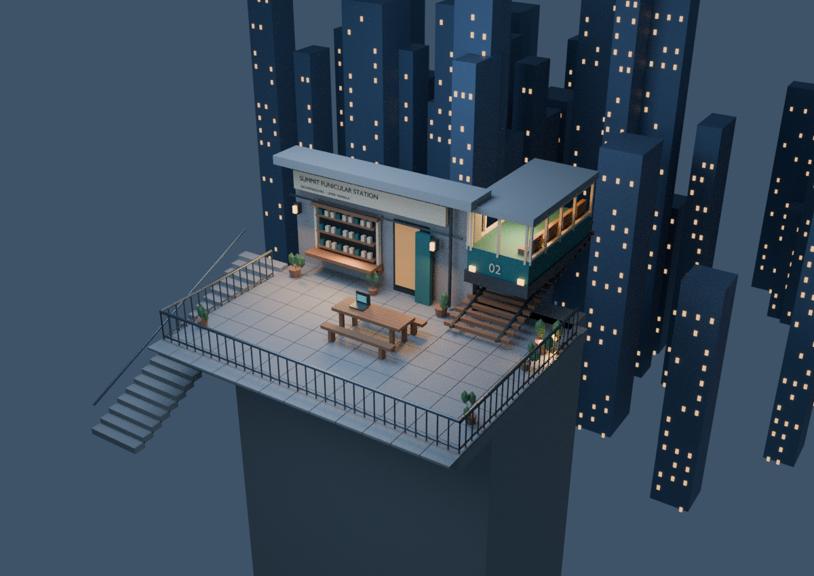
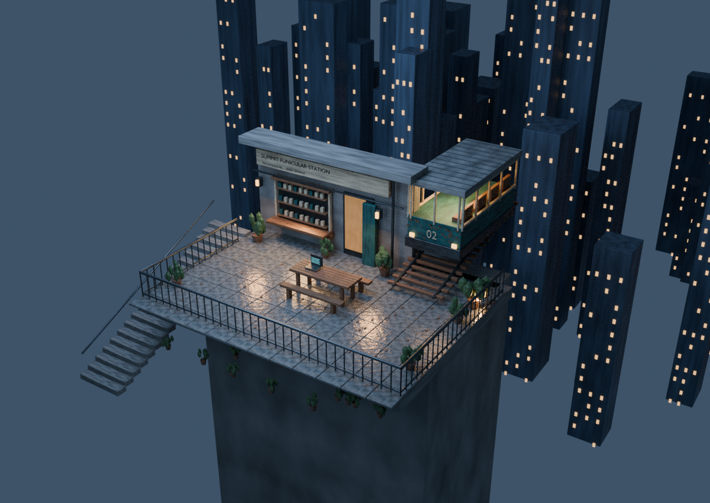

# Summit station workflow experiment

A procedural Blender reconstruction inspired by the supplied elevated funicular-station image. This repository tests **baseline → written realism report → implementation → comparison**.

## Render comparison

Open the images at full size to compare material and lighting details.

| Baseline | Improved |
| --- | --- |
|  |  |

[Full-size baseline](renders/baseline.png) · [Full-size improved render](renders/improved.png)

## Reproduce

Requires Blender 4.3.2; no add-ons, downloads, credentials, or Python packages are needed.

```sh
cd /workspace/solid-winner
mkdir -p scenes renders
blender -b --python-exit-code 1 -t 5 --python scene.py -- --stage baseline --samples 64
blender -b --python-exit-code 1 -t 5 --python scene.py -- --stage improved --samples 64
```

Outputs: editable `scenes/baseline.blend`, `scenes/improved.blend` and corresponding PNGs under `renders/`. Open either scene in Blender to inspect objects, materials and camera. Render output locations are resolved relative to the scene file. Run generation from this repository root.

Read [the improvement report](research/realism-report.md) and [results](research/results.md). The renders use actual geometry and Cycles, not image generation. This is a stylized approximation; the original's detail and photorealism are not guaranteed.
