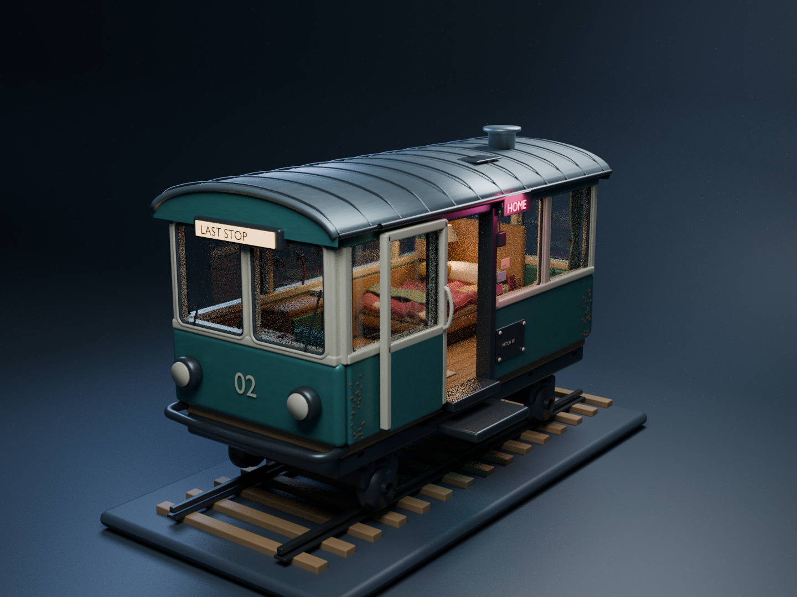
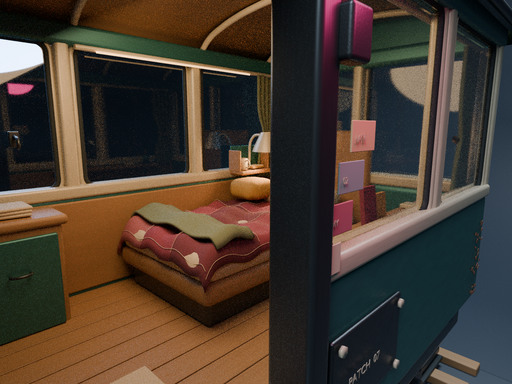
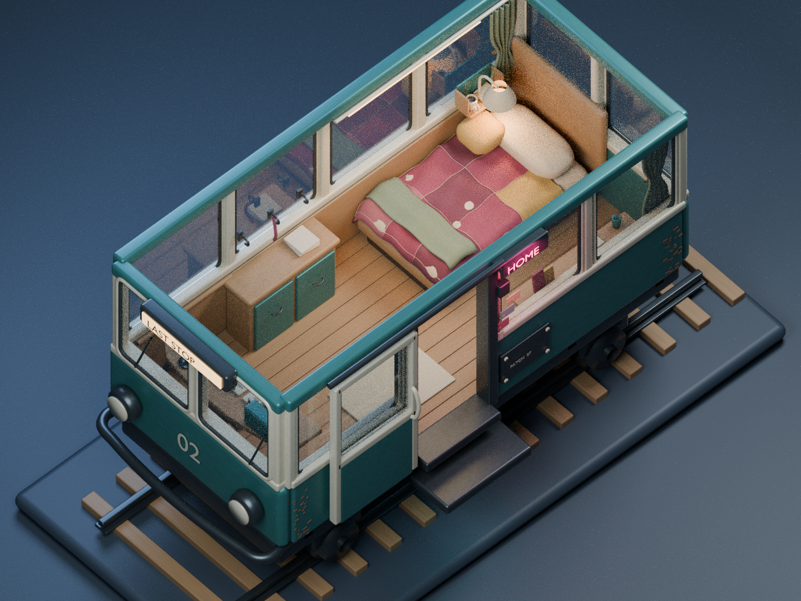
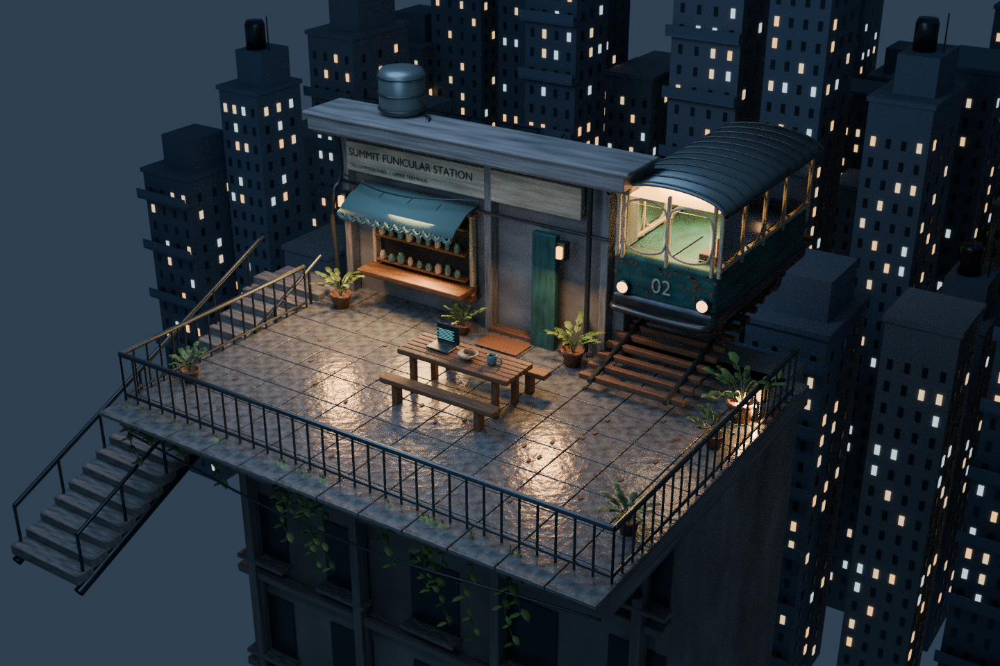
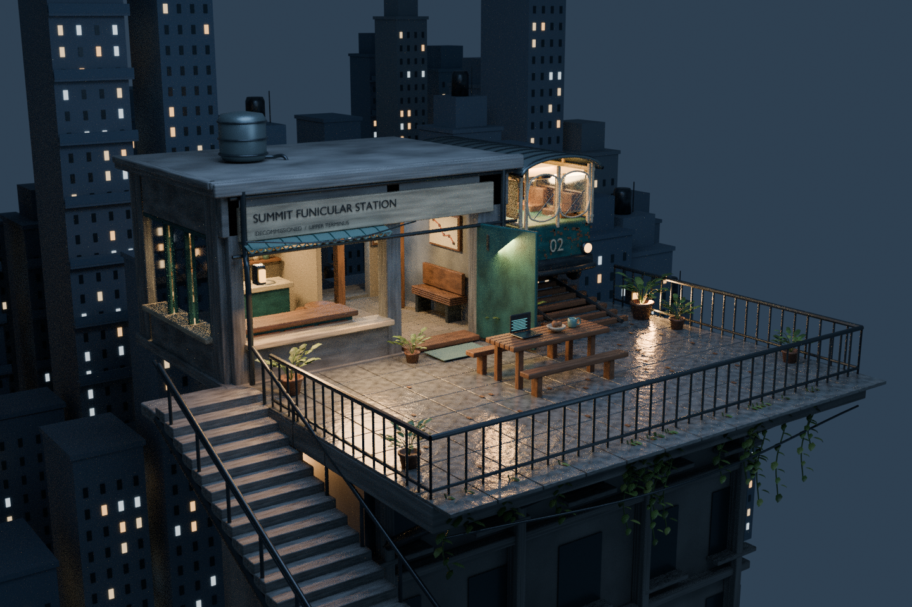
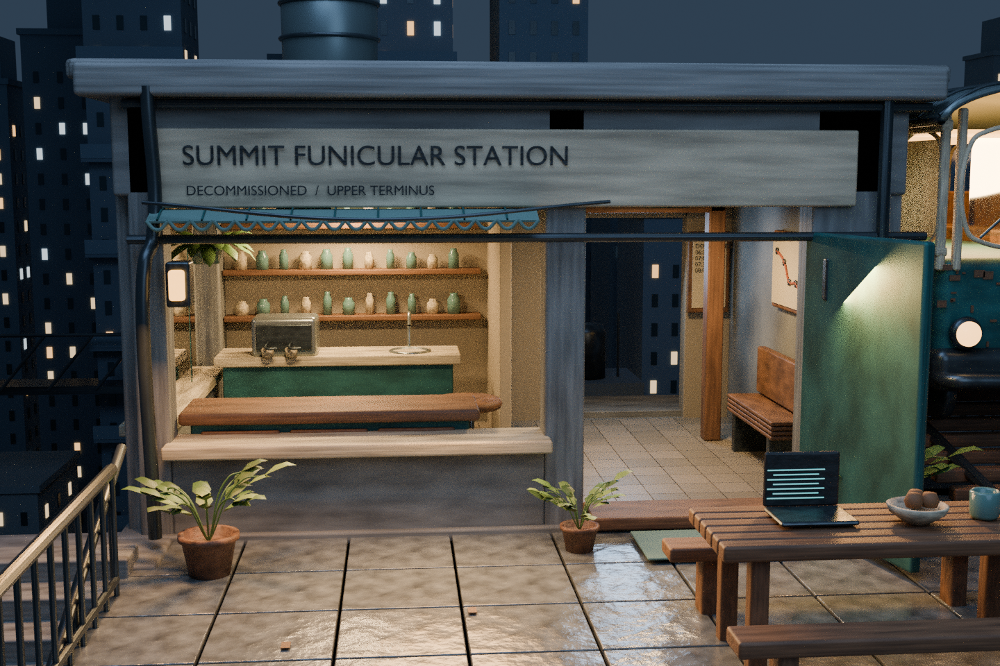

# Summit station workflow experiment

A procedural Blender reconstruction inspired by the supplied elevated funicular-station image. This repository tests **baseline → written realism report → implementation → comparison**.

## LAST STOP: standalone funicular bedroom

The [approved design brief](designs/funicular-bedroom.md) is now a separate, editable Blender asset: faded teal transit shell, fitted cab desk, rear bed with patched quilt and folded throw, tied curtains, sliding entrance, bolted repairs, warm reading light and restrained magenta/cyan accents.



| Open-door detail | Roof-off layout study |
| --- | --- |
|  |  |

[Full-size exterior](renders/bedroom-hero.png) · [Full-size doorway](renders/bedroom-entry.png) · [Full-size cutaway](renders/bedroom-cutaway.png) · [Editable Blender asset](scenes/funicular-bedroom.blend)

The roof is intact in the exterior and doorway views; the layout view deliberately hides its collection. Read the [build notes and validation](research/funicular-bedroom-build.md).

### Reproduce the bedroom asset only

From the repository root, this command builds a fresh scene and renders all three views. It requires no earlier `.blend` files:

```sh
blender -b --python-exit-code 1 -t 5 --python bedroom_funicular.py -- --view all --samples 96
```

Outputs are `scenes/funicular-bedroom.blend` and `renders/bedroom-{hero,entry,cutaway}.png`, at 1440 × 1080. The Blender file contains three named cameras and collections for the undercarriage, shell, removable roof, glazing, interior, textiles, props, lighting and presentation. Move `LAST_STOP_ASSET_ROOT` to move the car independently of the studio. Toggle the roof collection's render visibility to inspect the interior; select the cutaway camera for the layout composition. The default saved state uses the hero camera and intact roof.

Use `--samples 24 --scale 50` for quick drafts; these overwrite the corresponding PNGs but do not save the full-size Blender file. Rerun the full command to restore final images. `--view hero`, `--view entry`, or `--view cutaway` renders just one view. `--neon-off` disables colored accent emission/lights and appends `-warm` to image names for a warm-light check.

The quilt and curtains use controlled modeled folds, not cloth simulation. No external AI mesh service, add-on, texture downloads or Python packages are needed. This Blender build renders with Cycles CPU without OpenImageDenoise; final images retain some grain.

## Latest comparison: station interior and lower viewpoint

The station now has a complete five-metre-deep shell, a café, a waiting area and a rear passage. The main view moves lower and farther left to show the side wall; the companion close-up looks through the front openings into the rooms. The roof remains intact.

| Previous shape pass | New station and viewpoint |
| --- | --- |
|  |  |

[Full-size new exterior](renders/interior.png) · [Full-size interior close-up](renders/interior-detail.png) · [Previous render](renders/refined.png)

### Interior close-up



Read [the interior design report](research/interior-pass-report.md) and [observations](research/interior-pass-results.md). Editable scenes: [exterior](scenes/interior.blend) and [close-up](scenes/interior-detail.blend). The earlier [baseline](renders/baseline.png), [material pass](renders/improved.png), and [shape-pass report](research/shape-pass-report.md) remain available.

## Reproduce

Requires Blender 4.3.2; no add-ons, downloads, credentials, or Python packages are needed.

```sh
cd /workspace/solid-winner
mkdir -p scenes renders
blender -b --python-exit-code 1 -t 5 --python scene.py -- --stage baseline --samples 64
blender -b --python-exit-code 1 -t 5 --python scene.py -- --stage improved --samples 64
blender -b --python-exit-code 1 -t 5 --python refine_scene.py -- --samples 96
blender -b --python-exit-code 1 -t 5 --python interior_scene.py -- --view left --samples 96
blender -b --python-exit-code 1 -t 5 --python interior_scene.py -- --view detail --samples 96
```

Outputs: editable `scenes/baseline.blend`, `scenes/improved.blend` and corresponding PNGs under `renders/`. The third command loads `scenes/improved.blend` and creates `scenes/refined.blend` plus `renders/refined.png` at 1440 × 960. Use `--samples 24 --scale 60` on `refine_scene.py` for a quick draft; this overwrites only the refined outputs. Open any scene in Blender to inspect objects, materials and camera. Render output locations are resolved relative to the scene file. Run generation from this repository root.

Read [the improvement report](research/realism-report.md) and [results](research/results.md). The renders use actual geometry and Cycles, not image generation. This is a stylized approximation; the original's detail and photorealism are not guaranteed.

`./render.sh` reproduces all stages. To rerender only the latest pass, run the two `interior_scene.py` commands with the existing `scenes/refined.blend`. They write 1440 × 960 images and compressed editable scenes. For quick camera tests, `interior_scene.py -- --view all --samples 20 --scale 50` generates three draft PNGs; rerun the two full-size commands afterwards to restore the final images. No add-on or external AI mesh service is required; the procedural geometry is constructed through the Blender Python API.
